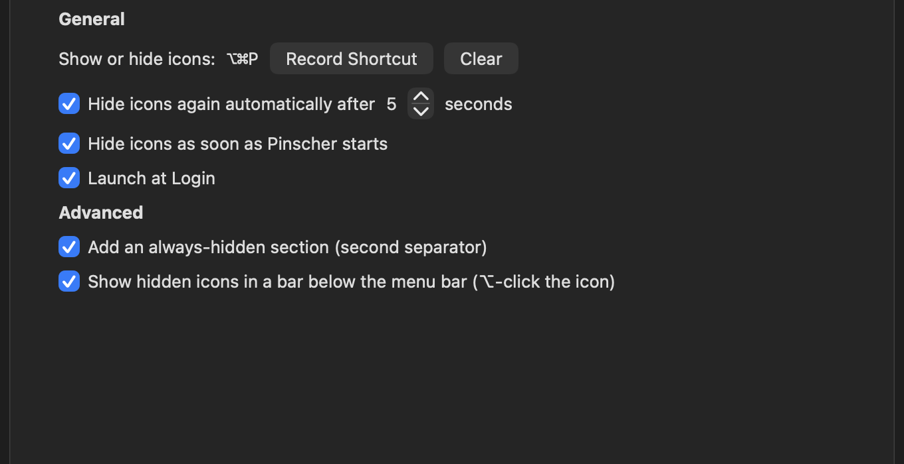

[Leia em português](README.pt-BR.md)

# Pinscher

<p align="center"></p>

Pinscher is a macOS menu bar manager that lets you hide menu bar items you do not need to see all the time.

## How it looks

Pinscher hides the icons you don't need as soon as it starts. Only what you want to see stays in the menu bar:


Click the pinscher icon (or press ⌥⌘P) and everything comes back. The thin slash marks the edge of the hidden area; icons to its left are the ones Pinscher hides:


Settings let you record the shortcut, choose when to hide again, and turn on the always-hidden section:



## Status

Early development. Behavior and configuration may change between releases.

## Features

- **Available:** Hide icons as soon as Pinscher starts, and show or hide them with a click.
- **Available:** Move the separator with ⌘-drag to choose which items stay hidden to its left.
- **Available:** Toggle visibility with ⌥⌘P and configure auto-hide and launch at login in Settings.
- **Available:** Optional always-hidden section with its own separator.
- **Experimental:** A second bar (⌥-click), item organization in the Layout tab, and explicit restoration of saved sections. Real capture and drag validation requires granting system permissions.

## Requirements

- macOS 14 or later
- Apple silicon or Intel Mac

## Install

Download a release from [GitHub Releases](https://github.com/djbrunoramon/pinscher/releases) and move `Pinscher.app` to Applications.

Release bundles are ad-hoc signed. If Gatekeeper blocks a build you trust, Control-click (or right-click) the app and choose **Open**. You can also remove quarantine from a trusted downloaded app in Terminal:

```sh
xattr -dr com.apple.quarantine /Applications/Pinscher.app
```

## Use

- Click the Pinscher menu bar icon to show or hide the items left of its separator.
- Right-click the icon or press ⌃ while clicking to open the menu.
- Press ⌥⌘P to toggle visibility.
- Hold ⌘ and drag a menu bar item to choose which items remain hidden to the left of the separator. The separator must be left of the Pinscher icon; otherwise Pinscher shows a warning and does not hide items.
- Enable **Launch at Login** from the menu. This works when Pinscher runs from its app bundle and may require approval in System Settings.
- Settings include auto-hide, shortcut recording, and the always-hidden section. Keep its divider left of the normal separator, and the normal separator left of Pinscher. Use **Reveal All Icons to Arrange…** from the menu to arrange hidden icons.
- Enable the second bar in Settings, grant Accessibility and Screen Recording when requested, then ⌥-click Pinscher. It uses in-memory snapshots when available and the application's icon otherwise. Activating an item reveals it temporarily; the previous visibility returns after the configured delay, including when auto-hide is off.
- In **Settings › Layout**, click **Refresh and Arrange…**, then choose each item's section. Closing Settings ends the arrangement session. **Restore Saved Layout** reapplies remembered sections on request; startup never moves items automatically.
- Items that disappear, have ambiguous identifiers, or cannot fit on screen may be skipped. Moving and activating items must be verified on your macOS version before relying on these experimental features.

## Permissions and privacy

The basic show/hide feature does not request Screen Recording or Accessibility permission. Advanced features that inspect or control other menu bar items may require Screen Recording to capture their appearance and Accessibility to interact with them. Permissions are requested only when enabling the second bar or explicitly starting organization. Without access, advanced features remain unavailable while the basic mode continues working. After granting access, enable the feature or refresh Layout again.

Pinscher makes no network requests and has no telemetry. Any captures used by advanced features are kept in memory; Pinscher does not save captured images.

## Build from source

Install Rust with rustup; it reads the pinned toolchain in `rust-toolchain.toml`. Then run:

```sh
cargo build
cargo test
./scripts/bundle.sh
```

The bundle script creates a universal, ad-hoc signed `dist/Pinscher.app`.

## Contributing

See [CONTRIBUTING.md](CONTRIBUTING.md) for setup, project boundaries, and the pull request process. Please report bugs using [GitHub Issues](https://github.com/djbrunoramon/pinscher/issues).

## License

Pinscher is licensed under the [MIT License](LICENSE).
