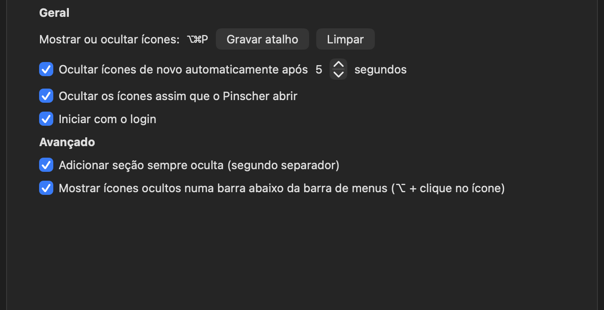

[Read in English](README.md)

# Pinscher

<p align="center"></p>

Pinscher é um gerenciador da barra de menus do macOS que permite ocultar os itens que você não precisa ver o tempo todo.

## Como fica

O Pinscher oculta os ícones de que você não precisa assim que abre. Só o que você quer ver fica na barra de menus:


Clique no ícone do pinscher (ou aperte ⌥⌘P) e tudo volta. A barrinha fina marca o limite da área oculta; os ícones à esquerda dela são os que o Pinscher esconde:


Nos Ajustes você grava o atalho, escolhe quando ocultar de novo e liga a seção sempre oculta:



## Status

Em desenvolvimento inicial. O comportamento e a configuração podem mudar entre versões.

## Recursos

- **Disponível:** Ocultar os ícones assim que o Pinscher abre, e mostrá-los ou ocultá-los com um clique.
- **Disponível:** Mover o separador com ⌘ e arrastar para escolher quais itens ficam ocultos à esquerda dele.
- **Disponível:** Alternar a visibilidade com ⌥⌘P e configurar ocultação automática e início com o login nos Ajustes.
- **Disponível:** Seção sempre oculta opcional, com separador próprio.
- **Experimental:** Segunda barra (⌥ + clique), organização na aba Layout e restauração explícita das seções salvas. A validação real da captura e do arraste exige liberar as permissões do sistema.

## Requisitos

- macOS 14 ou posterior
- Mac com Apple silicon ou Intel

## Instalação

Baixe uma versão em [GitHub Releases](https://github.com/djbrunoramon/pinscher/releases) e mova `Pinscher.app` para Aplicativos.

Os bundles de release têm assinatura ad-hoc. Se o Gatekeeper bloquear uma versão em que você confia, clique com o botão direito (ou Control-clique) no app e escolha **Abrir**. Também é possível remover a quarentena de um app baixado em que você confia pelo Terminal:

```sh
xattr -dr com.apple.quarantine /Applications/Pinscher.app
```

## Uso

- Clique no ícone do Pinscher na barra de menus para mostrar ou ocultar os itens à esquerda do separador.
- Clique com o botão direito no ícone ou pressione ⌃ enquanto clica para abrir o menu.
- Pressione ⌥⌘P para alternar a visibilidade.
- Segure ⌘ e arraste um item da barra de menus para escolher quais itens permanecem ocultos à esquerda do separador. O separador precisa ficar à esquerda do ícone do Pinscher; caso contrário, o Pinscher mostra um aviso e não oculta os itens.
- Ative **Iniciar com o login** pelo menu. Isso funciona quando o Pinscher é executado a partir do app e pode exigir aprovação nos Ajustes do Sistema.
- Os Ajustes incluem ocultação automática, gravação do atalho e seção sempre oculta. Mantenha o divisor dessa seção à esquerda do separador normal, e o separador normal à esquerda do Pinscher. Use **Revelar todos os ícones para organizar…** no menu para organizar os itens ocultos.
- Ative a segunda barra nos Ajustes, permita Acessibilidade e Gravação de Tela quando solicitado e use ⌥ + clique no Pinscher. Ela usa imagens em cache na memória e, quando não houver imagem, o ícone do aplicativo. Ao acionar um item, ele aparece temporariamente; a visibilidade anterior retorna após o atraso configurado, inclusive com ocultação automática desligada.
- Em **Ajustes › Layout**, clique em **Atualizar e organizar…** e escolha a seção de cada item. Fechar os Ajustes encerra a organização. **Restaurar organização salva** reaplica as seções sob demanda; o app não move itens automaticamente ao iniciar.
- Itens ausentes, com identificadores ambíguos ou sem espaço na tela podem ser ignorados. Verifique a movimentação e a ativação dos itens na sua versão do macOS antes de depender desses recursos experimentais.

## Permissões e privacidade

O recurso básico de mostrar e ocultar não solicita permissões de Gravação de Tela nem de Acessibilidade. Recursos avançados que inspecionem ou controlem outros itens da barra de menus podem exigir Gravação de Tela para capturar sua aparência e Acessibilidade para interagir com eles. As permissões só são solicitadas ao ativar a segunda barra ou iniciar a organização explicitamente. Sem acesso, os recursos avançados ficam indisponíveis e o modo básico continua funcionando. Após autorizar, ative novamente o recurso ou atualize a aba Layout.

O Pinscher não faz solicitações de rede e não tem telemetria. Capturas usadas por recursos avançados ficam na memória; o Pinscher não salva imagens capturadas.

## Compilar a partir do código-fonte

Instale o Rust com rustup; ele lê a versão fixada em `rust-toolchain.toml`. Depois, execute:

```sh
cargo build
cargo test
./scripts/bundle.sh
```

O script de bundle cria `dist/Pinscher.app` universal e com assinatura ad-hoc.

## Contribuir

Consulte [CONTRIBUTING.md](CONTRIBUTING.md) para ver a configuração do ambiente, os limites do projeto e o processo de pull request. Relate bugs em [GitHub Issues](https://github.com/djbrunoramon/pinscher/issues).

## Licença

O Pinscher é distribuído sob a [Licença MIT](LICENSE).
