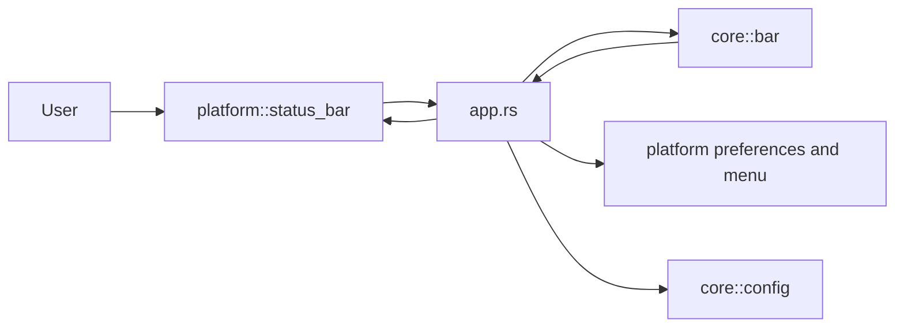

# Architecture

Pinscher is a native macOS menu bar app written in Rust. It uses AppKit through `objc2`; there is no Swift, web view, or cross-platform UI layer. The minimum supported OS is macOS 14.

## Layers

- `src/core/` holds platform-independent decisions and data. It does not call AppKit or CoreGraphics.
- `src/platform/` adapts macOS APIs to and from core types. Adapters do not make product decisions.
- `src/app.rs` connects platform events to core logic and applies the resulting platform actions.

## Toggle flow

A click on the Pinscher status item is handled by `platform::status_bar` and forwarded by `app.rs` to `core::bar`. The core decides whether collapsing is safe based on the item layout: the separator must be left of the Pinscher icon. The app then asks the status bar adapter to show the selected visibility by resizing the separator.

The separator expands to 10,000 points when collapsed. This is intentionally wider than a display, pushing menu bar items to its left off-screen. When expanded, it returns to its normal variable length.

## Configuration

`core::config` owns the TOML schema, defaults, validation, and warnings. The existing load/save functions receive their path from the platform and bound file size on both reads and writes. Verified section changes are rejected if they would exceed the schema limits.

## Logging

Logs use the `io.github.djbrunoramon.pinscher` subsystem and go to the unified macOS log. Log keys and error kinds only; do not log user paths, other apps' names, configuration values, or captured images.

## Advanced features

Accessibility discovers menu extras, including macOS 27's shared menu-bar items. The second bar uses bounded asynchronous ScreenCaptureKit captures of visible item frames. Before accepting a result, core checks geometry, identity and frame stability. Snapshots remain in memory and are cleared when capture access is revoked; missing snapshots use app icons. No automatic expansion is performed for capture.

The Layout tab reveals both dividers during an explicit arrangement session. Core produces an insertion-point drag plan within one menu-bar rectangle; platform checks the live identity, frame and divider geometry before posting the down and drag events. Timers release the mouse button without blocking the main thread. The delegate rediscovers the item and persists its section only after verifying the result. Saved sections are reapplied only through the user's restore action.

The insertion targets and event timing need validation with Accessibility enabled on each supported macOS version. A successful event post alone is never treated as a confirmed move.
